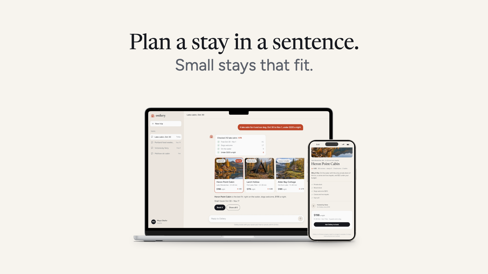

# Device mockups

Free. The founder's 2 November picks are the defaults: L2 has a short line and sentence, a tighter gap and no
pictured buttons. `reference/` is Ostlery, a fictional company with sample data. Start at SKILL.md.



```bash
npm install
node reference/render-mockups.mjs --check --check-fresh --stress
node reference/check-mockups.mjs
```

L1, T1-line and T2 retain their previous pixels. T2 puts the result in front and requires a visibly different
real state pair and a fresh reader before passing. The package is ready for an authorized run 2; that run
has not started. See reference/PROOF.md for proof status and reference/README.md for the editable files.
